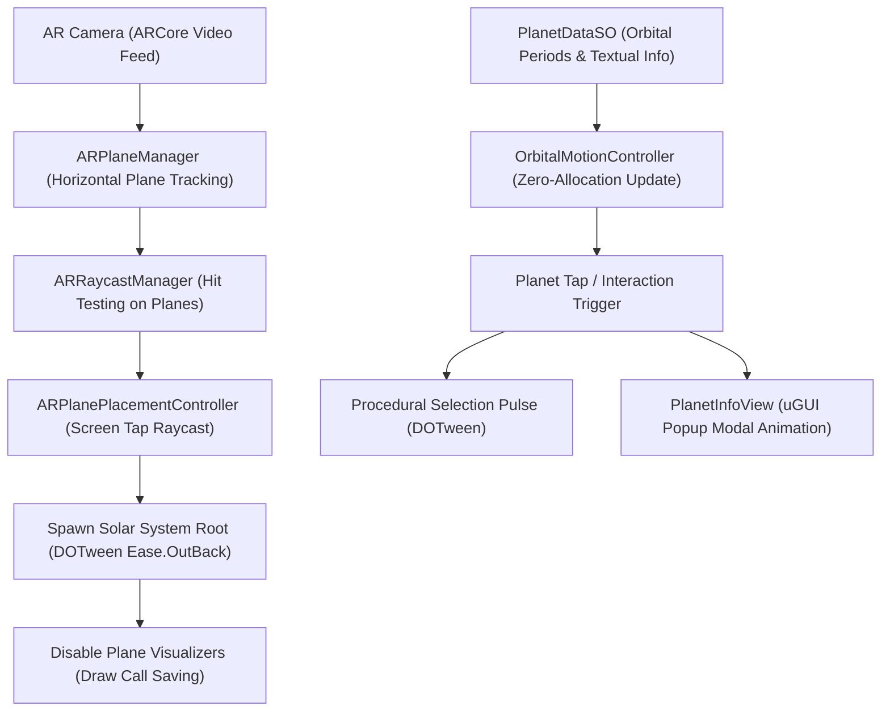

# Mobile AR Solar System Interactive Map

[](https://unity.com)
[](https://docs.microsoft.com/dotnet/csharp/)
[](https://docs.unity3d.com/Packages/com.unity.xr.arfoundation@latest)
[](http://dotween.demigiant.com/)

> **Note:** В данном репозитории представлен **архитектурный срез и ядро кодовой базы на C# (`Assets/Scripts`)** для технического ревью (Code Review). Тяжелые 3D-ассеты планет, текстуры высокого разрешения (4K/8K) и сторонние платные плагины исключены из публичной индексации Git.

---

## 📌 О проекте

Интерактивное образовательное мобильное приложение дополненной реальности (AR), разработанное в качестве **выпускной квалификационной работы (ВКР)** бакалавра по направлению «Прикладная информатика (в экономике)» (Тольяттинская академия управления, 2024).

Приложение проецирует интерактивную 3D-модель Солнечной системы на горизонтальные поверхности в реальном масштабе окружения, моделирует орбитальные траектории и осевое вращение планет и выводит образовательные карточки при взаимодействии.

---

## 🏗 Архитектура приложения (System Flow)



---

## 💡 Ключевые инженерные решения

### 1. Точная детекция поверхностей и оптимизация рендеринга ARCore
* Использование `ARRaycastManager` с фильтрацией по полигонам плоскостей (`PlaneWithinPolygon`).
* Сразу после успешного спавна Солнечной системы визуализаторы плоскостей ARCore отключаются программно — это экономит до 25% вызовов отрисовки (Draw Calls) на мобильных GPU.

### 2. Производительная симуляция без GC Alloc
* Орбитальные расчеты (`OrbitalMotionController`) выполняются на тригонометрических функциях с кэшированием структуры `Vector3`, полностью исключая выделение памяти (Garbage Collection) в цикле `Update()`.
* Анимации спавна, фокуса на планетах и карточек интерфейса реализованы через `DOTween` (с обязательным переиспользованием и очисткой твинов в `OnDestroy`).

### 3. Чистая архитектура данных (ScriptableObjects)
* Параметры всех небесных тел (периоды обращения, наклоны осей, радиусы, описание, цветовые схемы орбит) вынесены в `PlanetDataSO`, что позволяет легко расширять проект без правки программной логики.

---

## 📂 Структура кодовой базы

```text
Assets/Scripts/
├── AR/
│   └── ARPlanePlacementController.cs    # Детекция плоскостей, спавн и управление визуализацией ARCore
├── Configs/
│   └── PlanetDataSO.cs                  # ScriptableObject физических и текстовых параметров планет
├── Simulation/
│   └── OrbitalMotionController.cs       # Орбитальная механика, вращение и выбор планет без GC
└── UI/
    └── PlanetInfoView.cs                # Адаптивная карточка описания на uGUI Canvas с анимацией DOTween
```
